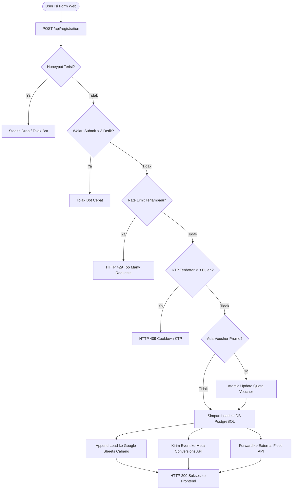

# 🚗 Laporan Analisis Menyeluruh & Dokumentasi Arsitektur Web Mobis

> **Proyek:** MOBIS Revamp (`mobis-revamp` / [`rentalmobis.com`](https://rentalmobis.com))  
> **Pemilik:** PT Global Mobility Service Indonesia (GMSI)  
> **Target Analisis:** Seluruh Basis Kode (Frontend Portal, Payload CMS v3, Lead Engine, Google Sheets Sync, Meta CAPI Tracking, AI Assistant & Chatbot Knowledge Base, Analytics Dashboard, dan CI/CD Pipeline)  
> **Tanggal Analisis:** Oktober 2026  
> **Status Build & Typecheck:** 🟢 **0 Errors (`tsc --noEmit` Pass)**  
> **Versi Codebase:** `1.0.0` (Branch `staging`)

---

## 📑 Daftar Isi

1. [Ringkasan Eksekutif & Karakteristik Arsitektur](#1-ringkasan-eksekutif--karakteristik-arsitektur)
2. [Peta Arsitektur & Struktur Direktori](#2-peta-arsitektur--struktur-direktori)
3. [Konfigurasi Inti (Next.js 16 + Payload CMS v3)](#3-konfigurasi-inti-nextjs-16--payload-cms-v3)
4. [Data Layer: Skema Database & Koleksi Payload CMS](#4-data-layer-skema-database--koleksi-payload-cms)
5. [Mesin Pendaftaran Driver (Core Business Flow)](#5-mesin-pendaftaran-driver-core-business-flow)
   - 5.1 Proteksi Anti-Bot Multi-Lapis (Honeypot + Min Submit Duration)
   - 5.2 Validasi KTP Cooldown (3 Bulan)
   - 5.3 Validasi & Klaim Voucher Promo Bersaing (Race-Condition Guard)
   - 5.4 Sinkronisasi Multi-Cabang Google Sheets
   - 5.5 Pelacakan Konversi Iklan (Meta CAPI Server-side & Pixel Client-side)
   - 5.6 Mekanisme Self-Healing PostgreSQL Sequence
6. [Sistem Widget Interaktif & AI Chatbot (`MobisWidget`)](#6-sistem-widget-interaktif--ai-chatbot-mobiswidget)
   - 6.1 Arsitektur Lazy Provider (Non-Blocking Core Web Vitals)
   - 6.2 Cek Status Pendaftaran Mandiri (Zero-PII Leak & In-Memory Cache)
   - 6.3 Proxy Chatbot AI Aman & Integrasi n8n Webhook (HMAC-SHA256)
7. [Modul Knowledge Base Chatbot FAQ (`ChatbotFaqs` & UI Admin)](#7-modul-knowledge-base-chatbot-faq-chatbotfaqs--ui-admin)
   - 7.1 Multi-Layer Ingestion (Database Vektor `chatBotMobisLocal` vs Payload vs Mock)
   - 7.2 Fitur Sync FAQ dari Google Sheet via n8n
   - 7.3 Fitur Apply to Production & Deteksi Kontradiksi AI
   - 7.4 Simulator Asisten Cerdas di Panel Admin
8. [Dashboard Analisis & Laporan Bisnis Internal (`Reports Engine`)](#8-dashboard-analisis--laporan-bisnis-internal-reports-engine)
9. [Arsitektur Konten Modular (Blocks System) & Core Web Vitals](#9-arsitektur-konten-modular-blocks-system--core-web-vitals)
10. [Standar Keamanan Siber & Ketahanan Sistem](#10-standar-keamanan-siber--ketahanan-sistem)
11. [Infrastruktur, Containerization & CI/CD](#11-infrastruktur-containerization--cicd)
12. [Temuan Teknis & Rekomendasi Pemeliharaan](#12-temuan-teknis--rekomendasi-pemeliharaan)

---

## 1. Ringkasan Eksekutif & Karakteristik Arsitektur

Platform **Web Mobis** (`rentalmobis.com`) adalah sistem operasional dan pemasaran pendaftaran rental mobil yang dikhususkan bagi mitra pengemudi daring (*driver online* Gojek, Grab, Maxim) serta kebutuhan korporasi/perorangan di berbagai wilayah operasional di Indonesia (Jabodetabek, Bandung, Surabaya, Malang, dan Bali).

### Karakteristik Utama Sistem:
* **Arsitektur Monolitik Modern:** Menyatukan Next.js 16 (React 19) App Router sebagai SSR/SSG frontend dan Payload CMS v3.73.0 sebagai backend/admin headless dalam satu repository dan satu deployment runtime Node.js.
* **Dual-Data Persistence:** PostgreSQL sebagai basis data transaksional utama (*Single Source of Truth*), disinkronkan secara *real-time* ke Google Sheets per wilayah cabang operasional untuk kebutuhan staf lapangan non-teknis.
* **Keamanan Berlapis (Defense-in-Depth):** Content Security Policy (CSP) ketat, sliding-window rate limiting di memori, proteksi CSV/Formula Injection, mitigasi bot tak terlihat (*stealth drop*), tanda tangan HMAC-SHA256 pada komunikasi webhook AI, serta isolasi data sensitif (Zero-PII leak policy).
* **Performa Ekstrem (Core Web Vitals):** Nilai Google Lighthouse Mobile mencapai **90+ (Performance)**, **93 (Accessibility)**, **100 (Best Practices)**, dan **100 (SEO)** dengan sinkronisasi preload LCP, dynamic code-splitting, dan konversi WebP otomatis.

### Ringkasan Tech Stack:
| Komponen | Spesifikasi / Teknologi |
|---|---|
| **Framework Utama** | Next.js 16 (App Router, standalone output) + React 19.2 |
| **Headless CMS** | Payload CMS 3.73.0 (Full TypeScript) |
| **Database Driver** | PostgreSQL 15+ via `@payloadcms/db-postgres` |
| **Rich Text Editor** | Lexical Editor (`@payloadcms/richtext-lexical`) |
| **Styling** | SCSS modular + Bootstrap 5.3 + Tailwind CSS v4 + Radix UI Primitives + Lucide Icons |
| **Integrasi Eksternal** | Google Sheets API (`googleapis`), Meta Graph & CAPI, TikTok Pixel, Google Tag Manager / GA4, n8n AI Workflow, Fleet Management System API |
| **Testing** | Vitest (Integration Testing) + Playwright (E2E Testing) |
| **Container & CI/CD** | Docker Multi-stage + GitHub Actions (CI & Migrate Workflow) |

---

## 2. Peta Arsitektur & Struktur Direktori

```
web-mobis/
├── .github/
│   ├── workflows/             # CI/CD (lint, test, build, deploy, migrate)
│   └── scripts/               # Guard scripts & remote deploy
├── public/                    # Aset statis publik (ikon SVG, logo, favicon)
├── scripts/                   # CLI maintenance (sync-media.mjs, setup-chatbot-faqs.mjs)
├── src/
│   ├── access/                # Fungsi RBAC (anyone, authenticated, authenticatedOrPublished)
│   ├── app/
│   │   ├── (frontend)/        # Rute halaman publik Next.js
│   │   │   ├── [slug]/        # Dynamic page builder dari CMS
│   │   │   ├── posts/         # Blog artikel & detail slug
│   │   │   ├── search/        # Halaman pencarian konten
│   │   │   ├── bootstrap-custom.scss # Custom SCSS Bootstrap (colors, grid)
│   │   │   ├── fonts.ts       # Font Inter lokal dengan font-display swap
│   │   │   ├── globals.css    # Tailwind CSS v4 directives
│   │   │   ├── layout.tsx     # Shell layout utama (Header, Pixels, GTM, MobisWidget, Footer)
│   │   │   └── style.css      # Styling global Mobis
│   │   └── (payload)/         # Rute Payload CMS (Admin & Custom API Endpoints)
│   │       ├── admin/         # UI Admin Panel (/admin) & importMap
│   │       └── api/           # Endpoint API kustom
│   │           ├── assistant/ # AI Chatbot webhook proxy, rating, sync, & apply-production
│   │           ├── open/      # Endpoint laporan bisnis terbuka terotorisasi token (/reports)
│   │           ├── registration/ # Mesin validasi & submit pendaftaran driver
│   │           ├── voucher/   # Validasi kupon promo
│   │           └── widget/    # Cek status pendaftaran mandiri
│   ├── blocks/                # Blok komponen visual CMS
│   │   ├── Mobis/             # 12 blok visual khusus Mobis
│   │   └── RenderBlocks.tsx   # Engine mapper blok modular dengan next/dynamic
│   ├── collections/           # Skema koleksi Payload CMS
│   │   ├── Categories.ts      # Kategori blog bertingkat
│   │   ├── ChatbotFaqs.ts     # Koleksi FAQ Q&A AI Assistant
│   │   ├── Customers/         # Data lead pendaftar rental mobil
│   │   ├── Media.ts           # Upload media & auto-resize WebP via Sharp
│   │   ├── Pages/             # Koleksi halaman dinamis CMS
│   │   ├── Posts/             # Artikel blog
│   │   ├── Users/             # Akun admin Payload
│   │   └── VoucherPromo/      # Kupon, kuota, masa berlaku & riwayat klaim
│   ├── components/            # Komponen React (Frontend & Admin UI)
│   │   ├── BootstrapClient/   # Lazy-load JS Bootstrap hanya saat interaksi pertama
│   │   ├── Dashboard/         # Custom panel dashboard admin
│   │   ├── FaqChatbot/        # Antarmuka manajemen vektor FAQ n8n & simulator
│   │   ├── GoogleTag/         # Integrasi Google Tag Manager / GA4
│   │   ├── MobisWidget/       # Widget floating (Cek Status, Chatbot, tombol aksi)
│   │   ├── PixelFacebook/     # Meta Pixel client-side
│   │   ├── PixelTiktok/       # TikTok Pixel client-side
│   │   └── Reports/           # Full-featured Analytics & Reporting Engine (Admin)
│   ├── fields/                # Reusable fields Payload (Lexical, Slug, URL)
│   ├── globals/               # Pengaturan Global CMS (Header, Footer, MobisWidgets)
│   ├── hooks/                 # Lifecycle hooks Payload (Revalidasi cache, slug)
│   ├── lib/                   # Business logic helpers
│   │   ├── customers/         # Filter lead pengujian (isExcludedLeadName)
│   │   ├── db/                # PostgreSQL sequence resync & healing script
│   │   ├── google/            # Google Auth client factory
│   │   ├── http/              # IP Resolver (x-forwarded-for, cf-connecting-ip)
│   │   └── security/          # In-memory rate limiting, sanitasi XSS, HMAC signing
│   ├── services/              # Layanan eksternal
│   │   ├── googleSheets/      # Multi-branch append lead ke Google Sheets
│   │   └── meta/              # Server-side Meta Conversions API (CAPI)
│   ├── utilities/             # Helper URL resolver, getMediaUrl, format mata uang, chatbotDb
│   ├── next.config.js         # Konfigurasi Next.js, CSP Headers, image allowlist
│   ├── package.json           # Dependensi & skrip runner
│   └── payload.config.ts      # Konfigurasi utama Payload CMS
```

---

## 3. Konfigurasi Inti (Next.js 16 + Payload CMS v3)

Inisialisasi dilakukan pada [`src/payload.config.ts`](file:///c:/Users/LENOVO/Documents/code/gms/web-mobis/src/payload.config.ts) dan dihubungkan ke Next.js via `@payloadcms/next/withPayload` di [`next.config.js`](file:///c:/Users/LENOVO/Documents/code/gms/web-mobis/next.config.js):

* **Database Connection & Safety:** Menggunakan `@payloadcms/db-postgres`. Opsi `push` dikontrol oleh `PAYLOAD_DB_PUSH` (wajib `false` di production untuk mencegah mutasi skema runtime yang berbahaya).
* **Auto Sequence Resync (`onInit`):** Saat server melakukan *bootstrapping*, sistem menjalankan `resyncPostgresSequencesOnInit(payload)`. Skrip ini menyelaraskan nilai serial sequence PostgreSQL ke nilai `MAX(id)` untuk mencegah error *duplicate key violation* pada tabel `customers`, `vouchers`, `pages`, dll.
* **Custom Admin Views:** Panel admin `/admin` diperkaya dengan:
  - `beforeLogin`: Komponen branding khusus Mobis ([`src/components/BeforeLogin`](file:///c:/Users/LENOVO/Documents/code/gms/web-mobis/src/components/BeforeLogin)).
  - `views.dashboard`: Dashboard statistik pendaftaran terbaru ([`src/components/Dashboard`](file:///c:/Users/LENOVO/Documents/code/gms/web-mobis/src/components/Dashboard)).
  - `views.reports`: Antarmuka visual analitik pendaftaran & repeat rate ([`src/components/Reports`](file:///c:/Users/LENOVO/Documents/code/gms/web-mobis/src/components/Reports)).
  - `views.faqChatbot`: Antarmuka manajemen knowledge base vektor AI dan simulator asisten ([`src/components/FaqChatbot`](file:///c:/Users/LENOVO/Documents/code/gms/web-mobis/src/components/FaqChatbot)).
* **Logger Optimization:** Pesan error *missing image on disk* diturunkan tingkat keparahannya ke `debug` agar tidak membanjiri log sistem dengan kebisingan yang tidak berbahaya.

---

## 4. Data Layer: Skema Database & Koleksi Payload CMS

| Koleksi / Global | Slug | Tipe | Keterangan & Aturan Bisnis |
|---|---|---|---|
| **Pages** | `pages` | Collection | Halaman dinamis modular berbasis blok visual. Mendukung drafts & versions. |
| **Posts** | `posts` | Collection | Artikel blog untuk edukasi mitra pengemudi dan SEO organik. |
| **Categories** | `categories` | Collection | Kategori konten bertingkat (*nested docs*). |
| **Media** | `media` | Collection | Upload berkas gambar dengan WebP conversion otomatis via Sharp. |
| **Users** | `users` | Collection | Manajemen pengguna admin RBAC. |
| **Customers** | `customers` | Collection | **Pusat Data Pendaftaran.** Menyimpan data lengkap identitas calon driver, snapshot JSON `rawPayload`, dan metadata Google Sheets `sheetMeta`. Hak akses `create: () => false` (hanya bisa diisi lewat API internal). |
| **Vouchers** | `vouchers` | Collection | Master kode promo, kuota pemakaian, masa berlaku, dan validasi wilayah. |
| **Voucher Categories** | `voucher_categories` | Collection | Kategori voucher promo. |
| **Voucher Redemptions**| `voucher_redemptions` | Collection | Pencatatan riwayat klaim kode voucher. |
| **Chatbot FAQs** | `chatbot-faqs` | Collection | Manajemen basis pengetahuan AI Q&A untuk n8n vector DB. |
| **Header** | `header` | Global | Menu navigasi navbar atas. |
| **Footer** | `footer` | Global | Logo dan tautan media sosial (IG, FB, TikTok, WA, YouTube). |
| **Mobis Widgets** | `mobisWidgets` | Global | Konfigurasi widget floating (tombol aksi, teks sapaan asisten, daftar wilayah cek status). |

---

## 5. Mesin Pendaftaran Driver (Core Business Flow)

Alur pendaftaran pendorong bisnis utama diproses melalui [`src/app/(payload)/api/registration/route.ts`](file:///c:/Users/LENOVO/Documents/code/gms/web-mobis/src/app/%28payload%29/api/registration/route.ts) dengan alur orkestrasi sebagai berikut:



### 5.1 Proteksi Anti-Bot Multi-Lapis
1. **Honeypot Trap:** Terdapat field tersembunyi yang hanya bisa dilihat oleh bot. Jika field ini terisi, sistem akan menolaknya (*stealth drop*).
2. **Minimum Human Submit Duration (`MIN_HUMAN_SUBMIT_MS = 3000`):** Pengisian formulir multi-langkah secara realistis memakan waktu belasan detik hingga menit. Pengiriman dalam waktu di bawah 3 detik otomatis ditandai sebagai automated script/bot.
3. **Sliding-Window Rate Limiting:** Batasan 5 request per 10 menit per IP address ([`src/lib/security/rateLimit.ts`](file:///c:/Users/LENOVO/Documents/code/gms/web-mobis/src/lib/security/rateLimit.ts)).
4. **Anti-XSS & Markup Rejection:** Fungsi `assertNoSuspiciousMarkup` menolak tag `<script>`, markup HTML, atau tautan mencurigakan.
5. **Anti-Formula Injection:** Fungsi `neutralizeSpreadsheetFormula` memberi *leading apostrophe* (`'`) pada data input yang diawali karakter `=`, `+`, `-`, `@`, `\t`, atau `\r` untuk mencegah eksekusi formula jahat di spreadsheet tim operasional.

### 5.2 Validasi KTP Cooldown (3 Bulan)
Fungsi `getKtpCooldownInfo` memeriksa nomor KTP calon pendaftar. Jika pendaftar pernah mengajukan permohonan dalam kurun waktu kurang dari 3 bulan (`KTP_REAPPLY_COOLDOWN_MONTHS = 3`), request akan ditolak dengan penjelasan tanggal kapan pendaftar boleh mendaftar kembali.

### 5.3 Validasi & Klaim Voucher Promo Bersaing
Pemakaian kuota voucher dieksekusi secara atomik menggunakan fungsi `incrementVoucherUsed` ([`src/lib/vouchers/incrementVoucherUsed.ts`](file:///c:/Users/LENOVO/Documents/code/gms/web-mobis/src/lib/vouchers/incrementVoucherUsed.ts)). Hal ini menjamin tidak terjadi *race condition* atau *over-redemption* saat banyak pendaftar memasukkan kode promo yang sama secara bersamaan.

### 5.4 Sinkronisasi Multi-Cabang Google Sheets
Fungsi `appendLeadToSheet` ([`src/services/googleSheets/appendLead.ts`](file:///c:/Users/LENOVO/Documents/code/gms/web-mobis/src/services/googleSheets/appendLead.ts)) secara cerdas memetakan lokasi serah terima unit (`handoverLocation`) ke lembar kerja yang sesuai:
* **Jabodetabek** (DKI Jakarta, Bogor, Bekasi, Tangerang, Tangerang Selatan, Depok) $\rightarrow$ `GOOGLE_SHEETS_SPREADSHEET_ID_JABODETABEK`
* **Bandung** $\rightarrow$ `GOOGLE_SHEETS_SPREADSHEET_ID_BANDUNG`
* **Surabaya, Sidoarjo, Gresik, Mojokerto** $\rightarrow$ `GOOGLE_SHEETS_SPREADSHEET_ID_SURABAYA`
* **Malang** $\rightarrow$ `GOOGLE_SHEETS_SPREADSHEET_ID_MALANG`
* **Bali** $\rightarrow$ `GOOGLE_SHEETS_SPREADSHEET_ID_BALI`
* **Fallback Wilayah Lain** $\rightarrow$ `GOOGLE_SHEETS_SPREADSHEET_ID_DEFAULT`

### 5.5 Pelacakan Konversi Iklan (Meta CAPI Server-side)
Modul [`src/services/meta/sendConversionsApiEvent.ts`](file:///c:/Users/LENOVO/Documents/code/gms/web-mobis/src/services/meta/sendConversionsApiEvent.ts) mengirimkan event `Lead` ke Meta Graph API (v23.0). Semua informasi pribadi (*PII*) seperti nomor telepon (diawali 62), nama depan, dan nama belakang di-hash menggunakan algoritma **SHA-256** sesuai spesifikasi Meta. Disertai deduplikasi event via `eventId` yang dicocokkan dengan event Facebook Pixel client-side.

### 5.6 Mekanisme Self-Healing PostgreSQL Sequence
Pada lingkungan container dan pasca-migrasi, serial sequence PostgreSQL rawan tertinggal dari nilai `MAX(id)` tabel, yang dapat menyebabkan error runtime `unique_violation` saat operasi insert. Proyek ini mengatasi hal tersebut dengan:
1. Skrip inisialisasi server `resyncPostgresSequencesOnInit` di [`src/lib/db/resyncPostgresSequences.ts`](file:///c:/Users/LENOVO/Documents/code/gms/web-mobis/src/lib/db/resyncPostgresSequences.ts).
2. Hook `ensurePageVersionIntegrity` di [`src/collections/Pages/hooks/ensurePageVersionIntegrity.ts`](file:///c:/Users/LENOVO/Documents/code/gms/web-mobis/src/collections/Pages/hooks/ensurePageVersionIntegrity.ts) yang mengisolasi field `id` dan menyelaraskan sequence tabel `pages` serta `_pages_v`.

---

## 6. Sistem Widget Interaktif & AI Chatbot (`MobisWidget`)

Widget mengambang (*floating action button*) di sudut kanan bawah halaman diatur melalui [`src/components/MobisWidget/`](file:///c:/Users/LENOVO/Documents/code/gms/web-mobis/src/components/MobisWidget/):

### 6.1 Arsitektur Lazy Provider (Non-Blocking Core Web Vitals)
Komponen `LazyMobisWidgetProvider.tsx` menggunakan `next/dynamic` dengan opsi `{ ssr: false }`. Hal ini memastikan kode widget chat dan modal yang berat tidak membebani server-side rendering dan tidak menambah Total Blocking Time (TBT) di sisi klien.

### 6.2 Cek Status Pendaftaran Mandiri ([`/api/widget/status-check`](file:///c:/Users/LENOVO/Documents/code/gms/web-mobis/src/app/%28payload%29/api/widget/status-check/route.ts))
Calon mitra dapat mengecek tahapan verifikasi pengajuannya menggunakan NIK atau Nomor HP:
* **Dual-Key Rate Limiting:** 10 request / 10 menit per IP, dan 5 request / 5 menit per NIK/Phone.
* **In-Memory Cache (TTL: 60 Detik):** Query berulang dalam 1 menit dilayani instan dari memori server (< 5 milidetik).
* **Zero-PII Leak Policy:** Sistem secara ketat membersihkan data upstream. Nama, nomor KTP, nomor HP, dan alamat tidak pernah dikembalikan ke antarmuka web publik; hanya indikator status tahapan (*timeline step*: `pending`, `in-progress`, `success`, `failed`) yang disajikan.
* **Integrasi Google Apps Script:** Menghubungi Google Apps Script backend menggunakan secret token (`MOBIS_GAS_SECRET_TOKEN`).

### 6.3 Proxy Chatbot AI Aman ([`/api/assistant`](file:///c:/Users/LENOVO/Documents/code/gms/web-mobis/src/app/%28payload%29/api/assistant/route.ts))
Sebagai jembatan antara pengunjung web dengan workflow AI n8n:
* **Fail-Closed Architecture:** Jika variabel environment `MOBIS_ASSISTANT_API_BASE` belum diset, sistem merespons dengan stub lokal yang aman tanpa mengekspos endpoint staging ke produksi.
* **HMAC-SHA256 Signing:** Setiap request ditandatangani menggunakan fungsi `signAssistantPayload` ([`src/lib/security/assistantSigning.ts`](file:///c:/Users/LENOVO/Documents/code/gms/web-mobis/src/lib/security/assistantSigning.ts)) dengan header `X-Mobis-Signature` dan `X-Mobis-Timestamp`.

---

## 7. Modul Knowledge Base Chatbot FAQ (`ChatbotFaqs` & UI Admin)

Modul terbaru yang dibangun untuk mengelola basis pengetahuan asisten AI secara terpusat dari panel admin Payload CMS (`/admin/faq-chatbot` dan `/admin/collections/chatbot-faqs`):

### 7.1 Multi-Layer Ingestion
Data tanya-jawab disajikan secara bertingkat:
1. **Layer 1 (Database Vektor n8n `chatBotMobisLocal`):** Membaca tabel PostgreSQL langsung (`n8n_vectors_mobis_dm_stg`, `n8n_vectors_mobis_comments_stg`, `n8n_vectors_mobis_dm`, `n8n_vectors_mobis_comments`) via [`src/utilities/chatbotDb.ts`](file:///c:/Users/LENOVO/Documents/code/gms/web-mobis/src/utilities/chatbotDb.ts).
2. **Layer 2 (Koleksi Lokal Payload CMS):** Jika koneksi vektor gagal, fallback ke data tabel `chatbot_faqs`.
3. **Layer 3 (Static Mock):** Cadangan data statis di `mockData.ts` sehingga tampilan UI tidak pernah crash jika koneksi database terputus.

### 7.2 Fitur Sync FAQ dari Google Sheet
Endpoint [`/api/assistant/sync`](file:///c:/Users/LENOVO/Documents/code/gms/web-mobis/src/app/%28payload%29/api/assistant/sync/route.ts) memicu alur sinkronisasi RAG di n8n untuk memperbarui dokumen embedding dari Google Sheets operasional ke tabel vektor Staging.

### 7.3 Fitur Apply to Production & Deteksi Kontradiksi AI
Endpoint [`/api/assistant/apply-production`](file:///c:/Users/LENOVO/Documents/code/gms/web-mobis/src/app/%28payload%29/api/assistant/apply-production/route.ts) menjalankan alur tinjauan AI sebelum dokumen diterapkan ke Live Production:
* AI n8n memindai jawaban baru terhadap basis pengetahuan yang sudah ada.
* Fungsi `extractN8nFeedback` mendeteksi apakah ada respon bertentangan (*kontradiksi*) atau duplikasi kategori.
* Hasil scan ditampilkan ke admin via komponen modal interaktif [`ScanFeedbackModal.tsx`](file:///c:/Users/LENOVO/Documents/code/gms/web-mobis/src/components/FaqChatbot/components/ScanFeedbackModal.tsx).
* Jika lolos verifikasi, data ditransfer secara atomik ke tabel live production (`n8n_vectors_mobis_dm` atau `n8n_vectors_mobis_comments`).

### 7.4 Simulator Asisten Cerdas di Panel Admin
Melalui komponen [`ChatbotFab.tsx`](file:///c:/Users/LENOVO/Documents/code/gms/web-mobis/src/components/FaqChatbot/components/ChatbotFab.tsx), staf admin dapat menguji respon AI secara langsung di dalam panel CMS tanpa harus mengisi formulir nama dan nomor HP secara manual (`initialStage="chat"`).

---

## 8. Dashboard Analisis & Laporan Bisnis Internal (`Reports Engine`)

Terletak di [`src/components/Reports/`](file:///c:/Users/LENOVO/Documents/code/gms/web-mobis/src/components/Reports/) dan dapat diakses dari menu admin `/admin/reports` serta API terbuka terotorisasi token di [`/api/open/reports`](file:///c:/Users/LENOVO/Documents/code/gms/web-mobis/src/app/%28payload%29/api/open/reports/route.ts):

* **Bucket Volume Pendaftaran:** Visualisasi tren harian, mingguan, dan bulanan (dihitung berdasarkan zona waktu WIB / Asia/Jakarta).
* **Analisis Pemohon Berulang (Repeat Applicants):** Mengelompokkan data berdasarkan nomor KTP dan Nomor HP untuk mendeteksi calon mitra yang mendaftar ulang berkali-kali.
* **Distribusi Geografis:** Statistik persentase domisili pendaftar di Jabodetabek, Bandung, Jawa Timur, dan Bali.
* **Performa Voucher Promo:** Rasio konversi pendaftar yang memanfaatkan kode promo vs non-promo.
* **Filter Data Lead Pengujian:** Menggunakan fungsi `isExcludedLeadName` ([`src/lib/customers/testLeadFilter.ts`](file:///c:/Users/LENOVO/Documents/code/gms/web-mobis/src/lib/customers/testLeadFilter.ts)) untuk membuang entri testing (nama seperti "test", "testing", "punten") agar metrik bisnis tetap akurat dan bersih.

---

## 9. Arsitektur Konten Modular (Blocks System) & Core Web Vitals

Landing page dinamis dibangun melalui 12 blok modular di [`src/blocks/Mobis/`](file:///c:/Users/LENOVO/Documents/code/gms/web-mobis/src/blocks/Mobis/):

1. **`BannerCarousel`**: Hero banner slider dengan dukungan gambar desktop & mobile responsif.
2. **`AreaChips`**: Kartu pemilihan pool wilayah operasional lengkap dengan modal foto lokasi pool.
3. **`About` (`AboutSplit`)**: Seksi pengenalan layanan Mobis dengan teks Lexical RichText dan visual pendukung.
4. **`ProgramDual`**: Komparasi program rental (Rent-to-Own / Kepemilikan vs Mingguan Reguler).
5. **`Requirements`**: Ketentuan umum dan persyaratan dokumen pengemudi.
6. **`UnitsAvailable`**: Katalog armada unit mobil (Avanza, Calya, Sigra) beserta tarif harian/mingguan.
7. **`Testimonials`**: Slider ulasan mitra pengemudi yang terhubung 100% ke CMS.
8. **`RegistrationForm`**: Formulir multi-langkah interaktif dengan validasi komprehensif.
9. **`RegistrationFlow`**: Infografis langkah pendaftaran driver.
10. **`FaqAccordion`**: Accordion tanya-jawab yang dioptimalkan dengan JSON-LD FAQ Schema.
11. **`ProgramCard`**: Kartu promo program tunggal.
12. **`FooterSimple`**: Footer sederhana dengan kontak cabang.

### Teknik Optimasi Core Web Vitals:
* **Selective Dynamic Splitting ([`RenderBlocks.tsx`](file:///c:/Users/LENOVO/Documents/code/gms/web-mobis/src/blocks/RenderBlocks.tsx)):** Blok berat seperti `RegistrationForm` diimpor via `next/dynamic`, sementara blok `BannerCarousel` diimpor langsung secara statis agar elemen Largest Contentful Paint (LCP) segera tersedia.
* **LCP Preload Link Injection ([`src/app/(frontend)/[slug]/page.tsx`](file:///c:/Users/LENOVO/Documents/code/gms/web-mobis/src/app/%28frontend%29/%5Bslug%5D/page.tsx)):** Sistem mengekstrak gambar varian responsif dari slide pertama `BannerCarousel` dan menyuntikkan tag `<link rel="preload" as="image" imageSrcSet="...">` langsung ke `<head>`.
* **Interaction-Based JS Loading ([`BootstrapClient`](file:///c:/Users/LENOVO/Documents/code/gms/web-mobis/src/components/BootstrapClient/index.tsx)):** Bundle JavaScript Bootstrap tidak dimuat saat inisiasi halaman, melainkan ditunda hingga pengguna melakukan scroll, sentuhan, atau klik pertama.

---

## 10. Standar Keamanan Siber & Ketahanan Sistem

1. **Content Security Policy (CSP):** Diatur pada `next.config.js` dengan membedakan rute publik dan panel admin:
   - Frontend dilindungi oleh CSP ketat yang hanya mengizinkan domain analitik resmi (Meta, TikTok, Google Analytics/Tag Manager).
   - Rute `/admin` dan `/api` dikecualikan dari pembatasan framing agar fitur Payload Live Preview tetap berfungsi.
2. **Staging SEO Cloaking (`NEXT_PUBLIC_NO_INDEX`):** Di branch atau domain staging, server mengirimkan header HTTP `X-Robots-Tag: noindex, nofollow, noarchive, nosnippet` serta memblokir perayap di `robots.ts` agar situs uji coba tidak terindeks oleh Google.
3. **SSRF Guard Protection:** Allowlist hostname gambar secara eksplisit pada `images.remotePatterns` di `next.config.js` dengan opsi `dangerouslyAllowLocalIP` terkontrol untuk mendukung loopback reverse-proxy di container yang sama.

---

## 11. Infrastruktur, Containerization & CI/CD

* **Multi-Stage Dockerfile ([`Dockerfile`](file:///c:/Users/LENOVO/Documents/code/gms/web-mobis/Dockerfile)):** Menggunakan base image `node:22.17.0-alpine` dengan tahapan `deps`, `builder`, dan `runner` (Next.js standalone runtime) untuk menghasilkan image berukuran ringkas dan efisien.
* **Aturan Kritis Database Migrasi:**
  - Deployment container sengaja mematikan migrasi build (`RUN_MIGRATIONS_ON_BUILD=false`).
  - Penambahan kolom ke skema Payload CMS (`Config.ts`) **wajib** disertai file migrasi dan dieksekusi terlebih dahulu ke database PostgreSQL produksi sebelum kode baru dirilis. Jika tidak, proses build Next.js (yang melakukan prerendering statis terhadap database aktif) akan mengalami kegagalan.
  - Alur migrasi dijalankan melalui workflow khusus [`.github/workflows/migrate.yml`](file:///c:/Users/LENOVO/Documents/code/gms/web-mobis/.github/workflows/migrate.yml) yang membuat cadangan database `pg_dump` otomatis sebelum eksekusi migrasi.

---

## 12. Temuan Teknis & Rekomendasi Pemeliharaan

| Area | Status Saat Ini | Analisis & Rekomendasi |
|---|---|---|
| **Rate Limiter & Cache** | In-Memory (`Map`) di memori Node.js | Sangat cepat untuk single-container. Jika di masa mendatang container di-scale secara horizontal (multi-replica di balik load balancer), pertimbangkan untuk memindahkan state rate limiter dan cache cek status ke **Redis**. |
| **Pilihan Mobil (`carUnit`)** | Hardcoded di `RegistrationForm/Component.tsx` | Saat ini belum menjadi field CMS untuk menghindari migrasi database. Jika tim bisnis ingin menambah jenis kendaraan baru secara dinamis, buat migrasi schema field `units` pada `RegistrationFormConfig`. |
| **Media Persistence** | Disimpan di volume lokal server | Pastikan folder uploads di-*mount* ke persistent volume Docker dan disinkronkan berkala menggunakan `scripts/sync-media.mjs`. |
| **Testing Coverage** | Vitest (1 int spec) & Playwright (1 e2e spec) | Rekomendasi untuk menambahkan integration test untuk validasi form pendaftaran (`/api/registration`), kalkulasi kupon voucher, serta alur cek status pendaftaran. |

---

> **Laporan Dibuat Oleh:** Antigravity AI Coding Assistant  
> **Status Basis Kode:** Siap untuk staging & production pipeline.
